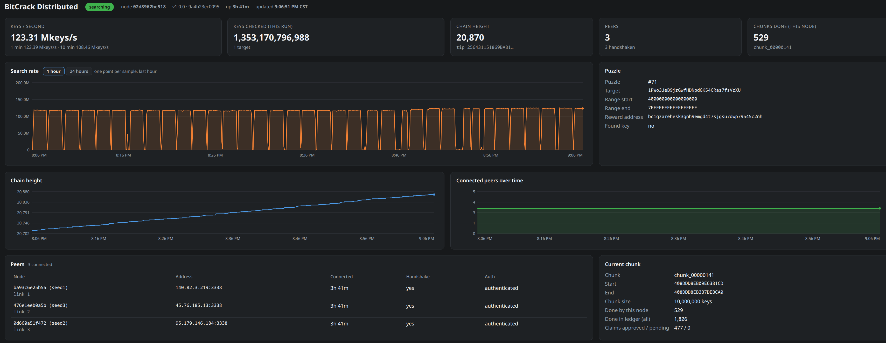
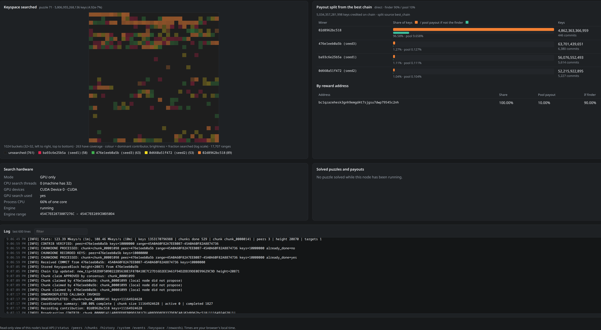

# BitCrack Distributed

A distributed Bitcoin puzzle solver with GPU acceleration and decentralized progress tracking.

## Project Status

BitCrack Distributed is under active development. Current limits:

- **GPU search: CUDA (NVIDIA) only.** The CUDA search kernel is on `main` and
  runs on an RTX 5070 (`sm_120`) node on the public network. OpenCL is still a
  stub; AMD/Intel GPUs are not used for searching.
- **Windows is built and tested in CI, not yet by a person.** Linux is the
  tested platform. The manual `Windows build` workflow compiles the console exe with
  MSVC, runs the test suite on Windows and uploads a ready-to-run zip; see the
  [Windows install guide](docs/INSTALL_WINDOWS.md). Please report what you hit.
- **CI is manual-only.** The GitHub Actions workflows (`CI`, `Launch gates`,
  `Windows build`, `Release`) run only when started by hand (`workflow_dispatch`). Changes are
  verified with a full local check run (Release, ASan and TSan test builds
  plus two-node smoke tests).

Open correctness and hardening work, with acceptance criteria, is tracked in
[docs/launch-blockers.md](docs/launch-blockers.md). The operator rehearsal and
failure-injection procedure is in [docs/launch-runbook.md](docs/launch-runbook.md).

## Overview

BitCrack Distributed is a cross-platform application designed to solve Bitcoin puzzle challenges through distributed computing. It combines GPU acceleration with a peer-to-peer network for coordinated range scanning and progress validation.

### Key Features (Current State)

- **Native CPU Scan Kernel**: self-contained secp256k1 field/group arithmetic with incremental point addition and batched affine conversion — ~1.5 Mkeys/s per core (~100x the former per-key OpenSSL path), differentially tested against OpenSSL on every build (see [docs/CPU_KERNEL.md](docs/CPU_KERNEL.md)).
- **Standalone Found-Key Flow**: a non-P2P client that finds a key journals it owner-only at once (0600 / Windows owner-only DACL) and auto-sweeps the target balance to your reward address, with retry, restart resume, and no key material ever logged.
- **Verified Puzzle Table**: puzzle addresses 71-160 validated against on-chain data (two independent trackers agree; every published solved key re-derives to its listed address in CI).
- **Binary Target Pipeline**: Engine, GPU manager, and network stack share raw hash160 targets for faster comparisons.
- **CUDA GPU Search**: a CUDA scan kernel (RTX 50-series / `sm_120` capable, default architectures `75;86;89;120`) runs beside the CPU threads, or alone with `--gpu-only`; every GPU candidate is re-verified on the host. See [docs/CUDA_KERNEL.md](docs/CUDA_KERNEL.md). OpenCL enumeration exists but its kernel is a stub.
- **Fast restarts**: a node re-checks its stored chain at startup but skips re-verifying the signatures it already verified before storing a block (an HMAC-protected checkpoint, keyed per node), so restarts take seconds instead of minutes; see [docs/startup-checkpoint.md](docs/startup-checkpoint.md).
- **Stable node id**: the node id is kept in `node_id.json` in the data directory as well as in `config.json`, so an emptied `config.json` does not rename the node.
- **Consensus & Rewards (Prototype)**: Lightweight vote-based consensus plus contribution-weighted reward ledger in the network layer.
- **Consensus Chain Mode (Beta)**: Block-based ledger (`network.enable_consensus_chain`, on by default) that records chunk completions in Merkle-linked blocks. Blocks are persisted and replayed onto genesis after a restart, and nodes sync the best chain by locator with paging.
- **P2P Puzzle Targets and Trust**: each node loads the active puzzle's target from its own puzzle table. Peers can't switch a node's puzzle; only a verifiably solved puzzle advances it.
- **Web dashboard**: `--dashboard` serves a live HTML dashboard at http://127.0.0.1:3339/ (keys/s and height charts, peers, chunks, hardware, keyspace map, payout split, log); see [Web dashboard](#web-dashboard).
- **Stats API**: optional read-only HTTP JSON API (`/status`, `/peers`, `/chunks`, `/rewards`, `/keyspace`, `/keyspace/ranges`, `/history`, `/system`, `/events`) plus a 60 s `Stats:` log line; see [Stats API](#stats-api-read-only-off-by-default).
- **Peer Discovery**: bootstrap hostnames are resolved on every attempt, and every address is tried. New configs default to the public seeds by hostname plus raw-IP fallback, and one address is dialed once per pass; see [Joining the public network](#joining-the-public-network-default-seeds). Peers also gossip endpoints (`PEERADDR`).
- **Cross-Platform Core**: Builds with CMake on Linux (tested) and macOS. Windows (MSVC) builds and passes the test suite in CI; see [docs/INSTALL_WINDOWS.md](docs/INSTALL_WINDOWS.md).
- **Resource Monitoring**: CPU usage sampling with configurable thresholds (GPU usage is not measured).
- **No desktop GUI**: the Qt GUI was removed (Nov 2026); the read-only web dashboard replaces it, and `--gui` now starts the dashboard and says so.
- **Extensible Architecture**: Modular libraries for core engine, GPU layer, network, and stats/dashboard API.

## Bitcoin Puzzle Challenges

This project targets the remaining Bitcoin puzzle challenges from https://privatekeys.pw/puzzles/bitcoin-puzzle-tx

These puzzles involve finding private keys for Bitcoin addresses with known public keys, requiring brute-force searching through key ranges.

## Architecture

```
┌─────────────────┐    ┌─────────────────┐    ┌─────────────────┐
│ Web dashboard   │    │  Network Layer  │    │  Validation     │
│                 │    │                 │    │  Consensus      │
│ • Controls      │◄──►│ • P2P Protocol  │◄──►│ • Range Proofs  │
│ • Monitoring    │    │ • Node Discovery│    │ • Rewards       │
│ • Settings      │    │ • Progress Sync │    │ • Leaderboard   │
└─────────────────┘    └─────────────────┘    └─────────────────┘
         │                       │                       │
         ▼                       ▼                       ▼
┌─────────────────┐    ┌─────────────────┐    ┌─────────────────┐
│  Core Engine    │    │ Resource Monitor│    │ Persistence     │
│                 │    │                 │    │                 │
│ • Key Generation│    │ • CPU/GPU Usage │    │ • Configuration │
│ • ECDSA Ops     │    │ • Auto Suspend  │    │ • Progress Save │
│ • Range Scan    │    │ • Thermal       │    │ • State Recovery│
└─────────────────┘    └─────────────────┘    └─────────────────┘
         │
- **Decentralized Work Distribution**: Pure consensus-based chunk claiming with peer voting eliminates single-point-of-failure. All nodes are equal peers using majority voting protocol (see [docs/ConsensusChunkClaiming.md](docs/ConsensusChunkClaiming.md)).
│                 │
│ • CUDA Compute  │
│ • OpenCL Compute│
│ • CPU Fallback  │
└─────────────────┘
```

## GPU Acceleration

> **Status:** the CUDA search kernel (`gpu/kernels/bitcrack_scan.cu`, math in
> `include/bcdgpu/`) is in use; design, build and test steps are in
> [docs/CUDA_KERNEL.md](docs/CUDA_KERNEL.md). The OpenCL `.cl` files and the
> older per-stage `.cu` files listed below are not used for searching yet.

The GPU layer covers CUDA and (planned) OpenCL:

### CUDA Kernels (NVIDIA GPUs)
- **secp256k1.cu** - Elliptic curve point multiplication on GPU
- **sha256.cu** - SHA-256 hashing optimized for Bitcoin
- **ripemd160.cu** - RIPEMD-160 hashing
- **hash160.cu** - Combined SHA256+RIPEMD160 for address generation
- **bitcrack.cu** - Main Bitcoin key checking kernel

### OpenCL Kernels (AMD, Intel, NVIDIA)
- Equivalent `.cl` implementations for cross-platform GPU support
- Automatically detects available OpenCL devices (GPU or CPU)
- Runtime kernel compilation for maximum portability

### GPU Architecture
The GPU implementation uses a pipeline approach:
1. Generate private keys in parallel on GPU
2. Compute public keys via secp256k1 point multiplication
3. Hash public keys (SHA-256 → RIPEMD-160) to get addresses
4. Compare against target addresses (hash160 format)
5. Report matches back to host

Kernel launches are managed by `CUDAKernel` and `OpenCLKernel` wrapper classes, which handle device initialization, memory management, and kernel execution.

## Building

### Prerequisites

- CMake 3.18+
- C++17 compiler (GCC 7+, Clang 5+, MSVC 2017+)
- OpenSSL 3.x (OpenSSL 4.x breaks the bundled asio's SSL helper on Windows; see docs/INSTALL_WINDOWS.md)
- Optional: CUDA Toolkit 12.8+ for GPU search (12.8 is the first with RTX 50-series / `sm_120`) and an NVIDIA driver 570+
- Optional: OpenCL SDK (for AMD/Intel/NVIDIA GPU acceleration)

### Build Instructions

```bash
# Clone and enter directory
git clone <repository-url>
cd BitCrackDistributed

# Configure out-of-source build (CPU only)
cmake -S . -B build -DCMAKE_BUILD_TYPE=Release -DDISABLE_CUDA=ON

# Build the core application
cmake --build build --config Release

# Run from the build tree (binaries land in build/<config>/)
./build/Release/bitcrack-distributed --reward <your BTC address>

# Same, with the web dashboard at http://127.0.0.1:3339/
./build/Release/bitcrack-distributed --reward <your BTC address> --dashboard

# Run with custom config
./build/Release/bitcrack-distributed --config my_config.json

# Run in daemon mode with CPU only and 50% power
./build/Release/bitcrack-distributed --cpu --power 50 --daemon
```

#### Linux with CUDA (NVIDIA GPU)

Install a CUDA toolkit 12.8 or newer (distro packages or NVIDIA's repository;
see [docs/CUDA_KERNEL.md](docs/CUDA_KERNEL.md)), then:

```bash
export PATH=/usr/local/cuda/bin:$PATH        # if nvcc is not on PATH already
cmake -S . -B build-cuda -G Ninja \
  -DCMAKE_BUILD_TYPE=Release -DDISABLE_CUDA=OFF \
  -DBITCRACK_CUDA_ARCH=120 -DBITCRACK_COPY_BUILD_TO_DIST=OFF
cmake --build build-cuda

./build-cuda/Release/bitcrack_tests "[gpu]"              # GPU tests (device tests skip without a GPU)
./build-cuda/Release/bitcrack-distributed --gpu-bench 20 # Mkeys/s on the GPU

# GPU only (no CPU search threads), with the dashboard
./build-cuda/Release/bitcrack-distributed --gpu-only --dashboard --reward <your BTC address>
```

`-DBITCRACK_CUDA_ARCH=120` builds for the RTX 50-series only; leave it out (default
`75;86;89;120`) for a binary that also runs on RTX 20/30/40-series cards. Without
`--gpu-only`, set `"gpu": { "enable_cuda": true }` in `config.json` to use the GPU
alongside the CPU threads.

### Windows (Visual Studio)

**Step-by-step guide: [docs/INSTALL_WINDOWS.md](docs/INSTALL_WINDOWS.md)** (Visual Studio 2022,
vcpkg OpenSSL 3, first run, firewall, dashboard and stats API, CUDA build for an RTX 5080).
CI builds and tests Windows (`.github/workflows/windows.yml`); the notes below predate that guide.

The repository ships with `build.bat`, which always configures the Visual Studio 2022 generator while auto-detecting `CUDA_PATH`/`nvcc`. The script forces execution from the repository root, so you can run it from any directory (including a PowerShell session already inside `build_vs2022`) or launch it via Explorer without worrying about the working directory.

```cmd
REM Run from anywhere on the machine
cmd /c "C:\path\to\BitCrackDistributed\build.bat"

REM Or invoke CMake manually
cmake -S . -B build_vs2022 -G "Visual Studio 17 2022" -A x64
cmake --build build_vs2022 --config Release
```

During configuration you may see informational messages such as `nlohmann/json not found - using basic string serialization` or `Catch2 not found - fetching v3.5.2`; the build script automatically downloads the missing optional dependencies. The generated binaries land in `build_vs2022\Release\bitcrack-distributed.exe` (or the chosen build directory).
> Note: On Visual Studio the build script avoids fetching large test dependencies by default to reduce heavy build steps and potential multi-config MSBuild issues. If you need Catch2 and unit tests locally, pass `-DBITCRACK_FORCE_FETCH_CATCH2=ON` when generating the build files so CMake fetches the test framework during configuration.

Note: By default the CMake build copies the built `bitcrack-distributed` binary into the `dist/windows/cli` folder after successful compilation.

This behavior can be configured three ways:
- Pass `-DBITCRACK_COPY_BUILD_TO_DIST=OFF` to `cmake` during configuration.
- Or pass the `no_copy` argument to the helper script: `build.bat no_copy` (or `build.bat copy` to force enabled).
- Or set `BITCRACK_COPY_BUILD_TO_DIST` directly when invoking `cmake`.

For example, to disable automatic copy via CMake directly:
```powershell
cmake -S . -B build_vs2022 -G "Visual Studio 17 2022" -A x64 -DBITCRACK_COPY_BUILD_TO_DIST=OFF
```

Or use the build helper to avoid copying in the build step:
```powershell
.\build.bat no_copy
```

#### Windows packaging

Use the PowerShell helper to copy the freshly built executable and the DLLs it needs (OpenSSL, CUDA runtime when present, MSVC runtime) into one folder:

```powershell
pwsh -ExecutionPolicy Bypass -File .\scripts\package_windows.ps1 -BuildDir build_vs2022 -OutputDir dist/windows
```

- `dist/windows/cli/bitcrack-distributed-cli.exe` – the node. Run it from a terminal; add `--dashboard` and open http://127.0.0.1:3339/ in a browser for the dashboard.

#### Linux packaging

Build and package a Linux tarball (CPU-only or with CUDA/OpenCL if available):

```bash
# From repo root
chmod +x scripts/package_linux.sh
CONFIG=Release DISABLE_CUDA=OFF ./scripts/package_linux.sh build_linux

# Optional: add tests
RUN_TESTS=1 ./scripts/package_linux.sh build_linux
```

Outputs:
- Binary and kernels under `dist/linux/`
- Tarball: `dist/bitcrack-distributed-linux.tar.gz`

Notes:
- If CUDA is unavailable, set `DISABLE_CUDA=ON` to silence detection attempts.
- Packaged binaries must stay portable: the build no longer uses `-march=native`
  by default. For a faster local-only build pass `CMAKE_ARGS="-DBITCRACK_NATIVE=ON"`
  (do not distribute those binaries — they can SIGILL on older CPUs).
- `BITCRACK_DISABLE_GPU=ON` builds a CPU-only stub of the GPU support library,
  so pure-CPU configurations configure and link cleanly.

### Consensus Chain Mode

The block-based ledger is on by default (`network.enable_consensus_chain` is `true`; `block_time_seconds` defaults to 300). When enabled, nodes wrap confirmed chunks into `COMMIT` messages, mine lightweight KeyspaceBlocks, and persist them to a shared ledger. Peers synchronize via `GETBLOCKS`/`HEADERS`/`GETDATA`/`BLOCK`: a node sends a block locator and keeps paging (up to 512 headers at a time) until it has caught up with its peer's best chain, and it reorganizes onto a heavier chain. Blocks received by sync are persisted, and on restart the stored blocks are replayed onto genesis, so a node keeps the synced chain. The replay skips re-verifying attestation signatures that this node already verified before storing the block ([docs/startup-checkpoint.md](docs/startup-checkpoint.md)); the first start after upgrading, or with a chainstore copied from another node, verifies everything once. Example configuration:

```json
{
  "network": {
    "enable_p2p": true,
    "enable_consensus_chain": true,
    "block_time_seconds": 180
  }
}
```

Notes:
- Commit quorum is fixed at 2 in code and not exposed via config.
- Late joiners catch up through the block sync above. An unsolicited `STATE` from a peer no longer switches a node's puzzle.

All nodes operate as equal peers in consensus mode, producing range blocks at the configured cadence while benefiting from deterministic replay.

### Performance Options

BitCrack Distributed supports command-line options to control CPU/GPU usage:

```bash
# Disable GPU acceleration, use CPU only
./bitcrack-distributed --cpu

# Set CPU usage limit to 60%
./bitcrack-distributed --power 60

# Combine both options
./bitcrack-distributed --cpu --power 50

# Search on the CUDA GPU only, with no CPU search threads
./bitcrack-distributed --gpu-only
```

The `--cpu` flag disables all GPU acceleration, forcing the application to use CPU threads only. The `--power` flag sets the CPU usage limit as a percentage (0-100), which affects how aggressively the resource monitor throttles CPU usage.

The `--gpu-only` flag is the opposite: it starts no CPU search threads and the CUDA GPU scans every key, which keeps the CPU cool on a GPU node. It turns CUDA on for that run (implies `--enable-gpu`; `config.json` is not changed), logs `GPU-only mode: 0 CPU search threads`, and exits with an error when no CUDA GPU is available (a build without CUDA, no device, or a driver that fails to initialize) rather than running a node that scans nothing. It cannot be combined with `--cpu`. `cpu_thread_count: 0` in `config.json` still means auto-detect, not GPU-only.

### Standalone search, tools, and benchmarking

Without P2P (`network.enable_p2p: false`) the client searches the puzzle pool
sequentially, starting at the first puzzle it has not already solved per its
found-key journal. These flags work on Linux and Windows:

```bash
# One-off custom search instead of the puzzle pool (no auto-advance):
./bitcrack-distributed --cpu --daemon \
    --target 1PWo3JeB9jrGwfHDNpdGK54CRas7fsVzXU \
    --range 400000000000000000 400000000000ffff

# Derive the compressed P2PKH address of any private key (utility/drills):
./bitcrack-distributed --derive-address 1
# -> address: 1BgGZ9tcN4rm9KBzDn7KprQz87SZ26SAMH

# Single-core CPU kernel benchmark (default 10 s):
./bitcrack-distributed --bench 5
```

When a key is found in standalone mode it is written immediately to
`<data_directory>/puzzleNNFoundKey.log` (owner-only: 0600 on POSIX, a
user/SYSTEM/Administrators-only protected DACL on Windows) with status
`found_payout_pending`, then the client signs a sweep of the target balance to
your `reward_address` with the found key and broadcasts it through the
configured backend (`electrum` by default). Failures retry with exponential
backoff and pending payouts resume from the journal after a restart — the same
record statuses the P2P payout path uses. The private key is never logged or
printed; `scripts/standalone_find_drill.sh` drills this whole flow end to end.

### macOS / Linux Notes

- Install OpenSSL headers (`brew install openssl` or distro equivalent) before configuring.
- CUDA is optional; if present, pass `-DCUDAToolkit_ROOT=/path/to/cuda` to CMake.
- OpenCL headers are detected automatically when present.

### Android (Termux)

A CPU-only command-line build runs on 64-bit Android phones in Termux, with the
dashboard in the phone's browser. `scripts/build_android.sh` cross-compiles it
with the Android NDK. See [docs/ANDROID.md](docs/ANDROID.md) for installing,
running, and battery and heat advice.

### macOS (Apple Silicon and Intel)

A CPU-only command-line build runs on Apple Silicon and Intel Macs, with the
dashboard in the browser. `scripts/build_macos.sh` builds it with a static
OpenSSL. See [docs/MACOS.md](docs/MACOS.md) for installing (including the
unsigned-binary Gatekeeper step), running, and choosing how many cores to use.

### Testing

The unit tests use Catch2 v3 and cover Base58 decoding, binary target engine logic, and the new networking helpers (consensus, discovery, rewards, protocol formatting).

```bash
# Build tests alongside the app
cmake --build build_vs2022 --config Release --target bitcrack_tests  # Windows example
cmake --build build --config Release --target bitcrack_tests         # POSIX

# Run the suite
build_vs2022/Release/bitcrack_tests.exe              # Windows
./build/Release/bitcrack_tests                       # POSIX
```

All current tests should pass; add new cases under `tests/` when extending the engine or address utilities.

### Contributing

See [CONTRIBUTING.md](CONTRIBUTING.md) for coding style, build/test expectations, and PR guidelines. A short PR template lives under `.github/` to keep reviews focused.

### Bitcoin-style consensus (in progress)

> Partly outdated: there are no coordinators any more. Every node is an equal peer, and the block sync described under "Consensus Chain Mode" is what runs today.

The next iteration of BitCrack Distributed introduces a Bitcoin-inspired, proof-of-work ledger for range completions. Coordinators assemble `CHUNKDONE` records into block templates, mine a header that satisfies a compact difficulty target, and broadcast the resulting block to peers. Other nodes validate the header hash, Merkle root, and individual range commitments before extending their local chain. Chain selection follows the most-work rule, so the active coordinator is always the miner of the current tip. See `docs/consensus-bitcoin.md` for the design notes.

**New protocol verbs**
- `INV` – announce one or more block hashes to peers
- `GETBLOCKS` – request headers starting from a locator set
- `HEADERS` – respond with contiguous block headers
- `GETDATA` – ask for the full block body for specific hashes
- `BLOCK` – broadcast a fully validated block with range commitments

### Consensus rules v4 (claim cap, commit quorum)

From block height **14400** (`consensus_v4::kDefaultActivationHeight`, about
1.5 days of blocks after this release at ~100 blocks/h) every non-genesis
block commitment must:

1. claim `0 < keys <= end - start + 1` (no keys beyond its range);
2. cover at most **2^36 = 68,719,476,736 keys** (twice the GPU default chunk
   of 32e9 keys; CPU and GPU chunk sizing is capped at this too);
3. carry a **commit quorum of 2 distinct nodes**: the miner plus at least one
   signed *attestation* by another node's key (secp256k1 signature over
   `dSHA256("BCD-ATT-v4|" + start + "|" + end + "|" + keys + "|" + miner)`,
   attester alias != miner, distinct pubkeys).

Before, a block was valid on format, Merkle root, timestamp and linkage
alone: every completer self-mints a one-commitment block, and the old
`commit_quorum` setting only gated a block-assembly path that never runs in
practice, so the effective quorum was 1. The quorum of 2 is the largest that
never stalls chain credit on today's network: with the three seeds alone, any
one of them may be down and every completion still gets an attestation (a
quorum of 3 would leave all seed work unminted whenever one seed is down).
It is a lower bound, not Sybil resistance (node keys are free).

How it works: a v4 node that credits a peer's signed CHUNKDONE (span and cap
checked) sends `COMMITATT:{range_start,range_end,keys,miner,alias,pubkey,sig}`;
nodes relay each new valid attestation once. The miner queues its own
completion (`Consensus v4: waiting for 1 attestation(s) ...`) and mints the
block when one arrives (`Consensus v4: minted KeyspaceBlock ... with N
attestation(s)`); unattested completions are dropped from the queue after
30 min (they keep their ledger credit). Attestations ride in the block JSON
(`attestations`, per commitment, persisted in the chainstore) and in compact
sync as `;@A|alias|pubkey|sig` segments after their commitment. They are not
in the Merkle root, so block hashes are unchanged. Local crediting rejects a
claim over the cap at any height (`CLAIM REJECTED (claim cap)`), and the
chain split ignores over-cap commitments.

**Compatibility (mixed old/new nodes).**
- Older nodes accept v4 blocks: they ignore the JSON field and the verb
  (`Unhandled raw message`), and skip the `@A|` sync segments (a commitment
  segment has exactly 5 comma fields).
- Below the activation height nothing changes; v4 nodes start attesting 100
  blocks early.
- From the activation height, v4 nodes reject an older node's self-minted
  (unattested) blocks with a `v4:` reason, logged at info, **with no strike**:
  connections stay up and the older node keeps its ledger credit and keeps
  getting chunks, but its work after activation gets no chain credit (so no
  share in a chain-split payout). An older node never attests, so a v4 node
  whose only peers are older nodes cannot mint either. A v4 block relayed
  through an older node loses its attestations in compact sync; v4 nodes
  fetch it from a v4 peer.
- **Upgrade every node (seeds, GPU nodes) before height 14400.**
- `network.consensus_v4_height` (0 = the default) overrides the activation
  height for test networks only; it must be the same on every node, and set
  before the chain passes it (a node replays its stored chain under it).

### Auto-Continue Ranges

When a node exhausts the current range (after `initwork <address> <start_hex> <end_hex> <chunk_size>`), it automatically advances to the next contiguous window of equal size and continues processing. This keeps all nodes busy without manual intervention.

- Applies to single-node and multi-node sessions
- Nodes claim new chunks via consensus voting as the range rolls forward
- For fixed one-off windows, pause after completion and manually start a new `initwork` window

## Stateful progress (work ledger)

BitCrack Distributed maintains a lightweight, persistent ledger of completed work so you can audit progress and resume with context after restarts.

- Storage format: JSON file per puzzle, named `workstate_p<NUM>.json`
- Location (default):
  - Windows: `%APPDATA%\BitCrackDistributed\workstate_p<NUM>.json`
  - macOS: `~/Library/Application Support/BitCrackDistributed/workstate_p<NUM>.json`
  - Linux: `~/.local/share/BitCrackDistributed/workstate_p<NUM>.json`
- Location (custom): set `data_directory` in your config to override the base directory

What’s recorded
- Context of the current window: `puzzle_number`, `target_address`, `range_start`, `range_end`, `chunk_size`
- A set of confirmed `completed` chunk IDs
- A small rolling buffer of recent completions with `{id,start,end,peer,keys}` for troubleshooting

How it updates
- On coordinator initialization (`initializeWork`), the node sets the ledger context and (if `save_progress` is true) attempts to load and then save the file so it exists on disk.
- When a worker completes a chunk, the coordinator:
  - Marks the chunk complete in `WorkCoordinator`
  - Credits contributions and broadcasts a `CONTRIB` delta to peers
  - Broadcasts `CHUNKDONE` (chunk_id|start|end|peer) and records the completion locally
- All peers record `CHUNKDONE` events to their local ledger; the coordinator’s view remains authoritative for assignments.

-Notes and current scope
- The ledger now hydrates the live scheduler at startup. On `initializeWork` (coordinator) and independent-node init/auto-continue, persisted completions are replayed via `markCompletedFromState`, contributions are restored, and the scheduler cursor advances so historical chunks are not reassigned.
- Duplicate `CHUNKDONE`/`WORKCOMPLETE` events are idempotent: once a chunk is recorded in the ledger, subsequent arrivals skip contrib/commit broadcasts and ledger writes.
- Block assembly occurs on the configured block interval in production; unit tests use helpers that assemble immediately after quorum to simplify assertions.
- Enable/disable and interval are controlled by config:
  - `save_progress` (bool)
  - `progress_save_interval_ms` (not all save points are throttled; CHUNKDONE persists immediately best-effort)
  - `data_directory` (string)

## Configuration

Configuration is stored in platform-specific locations:
- Windows: `%APPDATA%/BitCrackDistributed/config.json`
- macOS: `~/Library/Application Support/BitCrackDistributed/config.json`
- Linux: `~/.config/BitCrackDistributed/config.json`
- Android (Termux): `~/.config/BitCrackDistributed/config.json`; see [docs/ANDROID.md](docs/ANDROID.md)

### Joining the public network (default seeds)

A fresh clone joins the project's seed nodes with no edits. When no config file
exists, the node writes one whose `network.bootstrap_nodes` is:

```json
"bootstrap_nodes": [
  "seed.bitcrack-distributed.org:3338",
  "seed1.bitcrack-distributed.org:3338",
  "seed2.bitcrack-distributed.org:3338",
  "seed3.bitcrack-distributed.org:3338",
  "140.82.3.219:3338",
  "95.179.146.184:3338",
  "45.76.185.13:3338"
]
```

- The hostnames are resolved on every connect attempt (`seed.` carries one A
  record per seed). The raw IPs are the same three seeds (seed1-ewr, seed2-ams,
  seed3-sgp), a fallback while the DNS records don't exist yet. Until then,
  a node logs "Could not resolve peer host" for the hostnames every 5 minutes
  and connects through the IPs.
- One address is dialed at most once per connect pass, so a hostname and a raw IP
  for the same seed never produce two dials (or two connections) to it.
- A config file that sets `bootstrap_nodes` keeps exactly what it says, so a
  user's choice is never changed silently. A file with no `bootstrap_nodes`
  key gets the defaults. A file whose list is exactly one of the older built-in
  defaults (the hostnames-only lists earlier versions wrote on first run) is
  upgraded to the current list, and a log line says so.

**Opting out:**
- Set `"bootstrap_nodes": []` for a node that dials no one (it still accepts
  inbound peers on `network.port`).
- For a local-only test network, also set `"bind_address": "127.0.0.1"` and list
  only your own nodes, e.g. `["127.0.0.1:3338"]` (see P2P_SETUP.md).
- Use `"enable_p2p": false` for a standalone search with no networking at all.

The test suite and smoke scripts never use the default list. The test binary
empties it and refuses any outbound dial that isn't to loopback, and the smoke
script fails if a node connects to a non-loopback peer.

### Key Settings

```json
{
  "reward_address": "bc1...", // payout address (the alias comes from network.uuid)
  "cpu_usage": 75,
  "gpu_usage": 90,
  "auto_suspend": true,
  "network": {
    "enable_p2p": true,
    "port": 3338,
    "bind_address": "0.0.0.0",
    "max_peers": 8
  },
  "puzzle": {
    "target_range": "71",
    "batch_size": 1000000
  }
}
```

`network.bind_address` (default `"0.0.0.0"`) is the IPv4 address the P2P port
listens on. Leave it empty or set `"0.0.0.0"` to accept peers on every
interface (the default, unchanged). Set `"127.0.0.1"` for a local-only test
network. There is no command-line flag for this (unlike `--api-bind`, which
only affects the HTTP dashboard). The P2P stack is IPv4-only: an IPv6
literal or any other value that is not an IPv4 address is an error and the
node will not start, rather than silently listening on all interfaces. A
loopback bind is advertised as loopback and does not attempt UPnP.

#### Payouts (`enable_mpc`, default `false`)

When a node finds the puzzle key it pays out directly: it signs the payout
with the found key and broadcasts it (Electrum, or Bitcoin Core RPC with
`"bitcoin_backend": "bitcoind"` and `bitcoin_rpc_url` / `bitcoin_rpc_user` /
`bitcoin_rpc_password`). The finder's reward address gets
`finder_reward_pct` (default 0.90, 90%) of the balance, and the rest (the 10%
pool) is split among the *other* searchers by keys checked, from the finder's
contribution ledger. The finder takes no pool share: its own node, and any
other node paid to the same reward address, are left out of the split along
with their keys. Amounts are whole satoshis rounded down; anything the pool
cannot pay (searchers without a valid address, rounding, or no other
searchers) goes to the finder, so nothing is sent back to the puzzle address.
The wallet then drops outputs below the dust limit (their satoshis join the
largest output, normally the finder's) and, since a payout spends the whole
balance, takes the fee (50 sat/vB) from the outputs pro rata.

Example: 1 BTC prize; the finder scanned 2G keys, A 3G and B 1G. The finder
gets 0.9 BTC; the 0.1 BTC pool is split over A and B's 4G keys: A 0.075 BTC,
B 0.025 BTC (each less its part of the fee).

The pool share is always `1 - finder_reward_pct` (there is no separate pool
setting). A `finder_reward_pct` outside 0..1 falls back to the 90% default.

**Which keys count: the chain split.** The pool is split by the keys each
searcher has on the *best chain*, so every node with the same chain computes
the same split (the finder's local ledger is used only if the chain has no
commitments for the puzzle, e.g. not synced yet; it logs a warning). Rule:
the best chain's commitments are taken in chain order and each key is
credited to the first commitment that covers it; a commitment counts at most
its `keys` (start .. start + keys - 1) and only inside the puzzle range; the
genesis commitment is skipped. A miner id's reward address comes from the
node's address book (the `REWARDADDR` its peers announce); an older alias that
is a reward-address prefix maps to the one known address with that prefix.
(The `reward_address` a block's JSON may carry is not covered by the block
hash, so it is not trusted.)

**Peers check the payout.** When a verified-solved puzzle's `PAYOUT` arrives,
each node recomputes the split from its chain on the announced total (so the
pro-rata fee cancels) and compares: an address the split gives at least 546
sats that receives less than expected minus 0.5% (at least 600 sats) is a
mismatch, logged as `PAYOUT CHECK MISMATCH ... (flagged locally)` and shown in
`/rewards` `payout_checks`. Flagging is local only (no penalty), and advisory:
blocks minted after the finder's snapshot, or a different address book, can
cause a mismatch too. `/rewards` shows the split as `chain_split` (miners,
addresses, `pool_payout_percent`), with `payout.split_source` `best_chain`
or `local_ledger`.

Keys credited for a completion are bounded by its range: a CHUNKDONE or
CONTRIB (or a ledger entry from an older build) claiming more keys than
`end - start + 1` is credited the span and logged (`CLAIM KEYS CLAMPED`,
`CONTRIB KEYS CLAMPED`, `LEDGER KEYS CLAMPED`); fewer keys (a chunk stopped
early) are credited as claimed; a range that does not parse or runs
backwards is not applied (`CLAIM REJECTED (bad range)`). No wire change.

If the backend is unreachable when the key is found, the payout is not given
up and an empty answer is never mistaken for a zero balance. The key stays
recorded as `found_payout_pending` in `<datadir>/puzzleNNFoundKey.log` (mode
0600) and the balance lookup / broadcast is retried with exponential backoff,
starting at `payout_retry_initial_s` (default 30) and capped at
`payout_retry_max_s` (default 600). Retries are idempotent: the signed
transaction is written to the same file (`payout_signed`) before it is first
broadcast and is never rebuilt; before re-sending, the node checks whether the
tx is already in the mempool or confirmed, and only rebroadcasts the identical
signed tx. Progress is journaled (`payout_broadcast`, `payout_confirmed`, or the
terminal `no_balance` / `payout_inputs_spent`), and a restarted node resumes
any unfinished payout from that file. The puzzle is marked solved for search
scheduling as soon as the key is found; payout state is tracked separately.
The found-key files also mark puzzles as solved across restarts: a node that
starts on a puzzle it solved itself (any `puzzleNNFoundKey.log` in its data
directory for that puzzle's address) moves on to the next puzzle, in order,
that it has not solved, instead of searching the solved range again. After a
find, when no later puzzle is found by balance, the node advances the same
way (skipping puzzles it has already solved); if none is left it stays on the
current puzzle and logs a warning.

```json
{
  "payout_retry_initial_s": 30,
  "payout_retry_max_s": 600
}
```

Multi-party (MPC) payouts are **off by default** and experimental. A puzzle
address has a single key that only the finder holds and no key shares exist,
so a multi-party payout can never collect `mpc_threshold` independent
signatures. Set `"enable_mpc": true` only for experiments; the node logs a
warning at startup when it is on. A config file without `enable_mpc` gets
`false`; an explicit `true` is respected.

```json
{
  "enable_mpc": false
}
```

You can configure a built-in Electrum backend instead of a local Bitcoin Core node by setting `bitcoin_backend` to `electrum` and listing electrum server endpoints in `electrum_servers`. Example:

```json
{
  "bitcoin_backend": "electrum",
  "electrum_servers": ["electrum.blockstream.info:50002", "electrum.blockstream.info:50001"]
}
```

Note: Do NOT commit your local `config.json` to the repository. The repository includes a single `config.json` template; keep local modifications out of version control (use `git rm --cached path/to/config.json` to untrack local changes).

Cleanup checklist (recommended before push):
- Add or update `.gitignore` (already included).
-- Replace any committed `config.json` changes by untracking it and committing the sanitized template: `git rm --cached path/to/config.json`.
- Remove large build directories from git history if necessary (use BFG or git-filter-repo).

## Re-searching ranges (optional)

If a node reported ranges it never actually scanned, you can have your own node
search them again without touching the chain or the completion ledger:

```json
{
  "network": {
    "rescan_ranges_file": "rescan_ranges.txt",
    "rescan_ignore_completions_from": ["bc1qzarehe"]
  }
}
```

- `rescan_ranges_file`: one `start-end` hex range per line (`#` comments and
  blank lines are ignored). A relative path is resolved under `data_directory`.
  The file is read once at startup.
- `rescan_ignore_completions_from`: the peer aliases whose completions should
  not count for the listed ranges.
- A listed range (or part of one) is un-retired locally only when no peer
  outside the ignore list has completed it. It then goes to the front of the
  requeue, so it gets claimed before random gaps. Unlisted ranges aren't affected.
- Your node's own completions count. After a restart it re-checks the ledger
  and doesn't search finished ranges again, so you can leave the list in place.
- `/status` reports `rescan.listed` and `rescan.remaining`. The log shows
  `Rescan (...): R of N listed range(s) remain`, at startup, every 10 minutes
  and after each matching completion.
- No wire-format change. Other peers see ordinary claims and CHUNKDONEs.

## Web dashboard

Start a node with `--dashboard` and open **http://127.0.0.1:3339/** in a
browser on the same machine:

```bash
./bitcrack-distributed --gpu-only --dashboard
# log: Dashboard: http://127.0.0.1:3339/  (open it in a web browser on this machine)
```

The page is compiled into the binary (HTML, CSS and JS in one file, charts
drawn as inline SVG and canvas; nothing is loaded from the internet) and
refreshes itself from the stats API below: status and keys/s (now, 1 min,
10 min), a keys/s chart over the last hour or 24 hours, chain height and
peers over time, the peer list, the current chunk, the current puzzle (target
address, on-chain balance, reward address),
search hardware (CPU threads, GPU-only mode, GPU devices, process CPU), the
keyspace coverage map and the best-chain payout split, solved puzzles with
their payouts, and the node's recent log lines. It is read-only: it cannot
start, stop or reconfigure the node.



*A GPU node on the public network at 123 Mkeys/s: search rate, chain height, peers, and the current chunk.*



*Further down the same page: keyspace coverage, payout split from the best chain, search hardware, and the live log.*

- `--dashboard` is the same as `"api_enabled": true`; `--api-bind host:port`
  overrides `api_bind` for one run (e.g. a second node on one machine:
  `--api-bind 127.0.0.1:3340`).
- On a remote machine, tunnel it: `ssh -L 3339:127.0.0.1:3339 user@host`, then
  open http://127.0.0.1:3339/ locally.
- A loopback-bound API answers only requests whose `Host` header is a loopback
  name or address (403 otherwise), so a web page you visit cannot read it via
  DNS rebinding. The log panel is filled only when the API is bound to
  loopback.

## Stats API (read-only, off by default)

Each node can serve its search statistics as JSON over plain HTTP/1.1 on its
own thread. It only reads state; it never changes the engine or the P2P layer.

```json
{
  "api_enabled": true,
  "api_bind": "127.0.0.1:3339",
  "api_allow_remote": false,
  "api_puzzle_balance": true,
  "api_puzzle_balance_interval_s": 300
}
```

- `api_enabled` (default `false`), `api_bind` (default `127.0.0.1:3339`).
- `api_puzzle_balance` (default `true`) looks up the current puzzle address's
  on-chain balance through the configured Electrum servers (`electrum_servers`;
  the same backend the wallet uses, but a dedicated connection so a dashboard
  refresh never blocks a payout). The result is cached and refreshed every
  `api_puzzle_balance_interval_s` seconds (default 300, clamped to 30–3600).
  The first lookup starts as soon as the dashboard is up. The fetch runs on a
  background thread: it never blocks the API handler or the search/P2P
  threads. Mainnet only; on regtest/testnet, or if the lookup fails, the
  Puzzle panel shows "unavailable". Set `api_puzzle_balance` to `false` to
  disable the lookup.
- A non-loopback `api_bind` (e.g. `0.0.0.0:3339`) is refused at startup unless
  `api_allow_remote` is `true`. There is no authentication or TLS, so keep it on
  loopback and reach it over SSH (`ssh host curl -s http://127.0.0.1:3339/status`).
- GET only. Unknown paths get 404, other methods 405, malformed requests 400,
  request heads over 8 KiB get 431, and a client that doesn't finish its
  request within 2 s gets 408. One connection at a time, `Connection: close`.
- A failed bind is logged and the node keeps searching without the API.

| Endpoint | Fields |
|---|---|
| `GET /status` | `node_id`, `version`, `commit`, `puzzle` (`number`, `address`, range, `balance_sats` / `balance_unconfirmed_sats` / `balance_checked_at` (unix ms) / `balance_source` / `balance_pending`; `balance_sats` is null until a successful lookup), `target_count`, `keys_per_second` (last ~5 s), `keys_per_second_1m`, `keys_per_second_10m`, `total_keys_checked` (since start), `uptime_seconds`, `current_chunk` (`id`, `start`, `end`), `chunks_completed_local`, `chain` (`height`, `tip`), `peer_count`, `reward_address`, `found_key` (true/false only), `engine_running`, `rescan` (`listed`, `remaining`; only when a rescan list is set) |
| `GET /peers` | `count`, `peers[]`: `id`, `alias`, `address`, `connected_seconds`, `handshake_complete`, `auth` |
| `GET /chunks` | `completed_total`, `completed_local`, `completed_unrewarded`, `completed_by_peer`, `claims_approved`, `claims_pending`, `chunk_size`, `current_chunk` |
| `GET /rewards` | `payout` (`mode`, `enable_mpc`, `mpc_threshold`, `finder_percent`, `contributor_pool_percent`, `bitcoin_network`), `total_keys`, `peer_count`, `peers[]`, `addresses[]`, `keys_without_valid_address`, `keys_unique_searched` |
| `GET /keyspace` | `available`, `puzzle`, `range_start`, `range_end`, `keyspace_keys`, `keys_searched`, `keys_searched_decimal`, `fraction_searched`, `percent_searched`, `range_count`, `contributor_count`, `sources` |
| `GET /keyspace?buckets=N` | the above plus `bucket_count`, `bucket_keys`, `contributors[]`, `buckets` (`fraction[]`, `dominant[]`) |
| `GET /keyspace/ranges?offset=O&limit=L` | `total`, `offset`, `limit`, `ranges[]`: `start`, `end`, `keys`, `contributor`, `reward_address` |
| `GET /history` | `fields` (`t_ms`, `keys_per_second`, `height`, `peers`, `total_keys_checked`), `points[]` (one per 5 s sample, last 720 = 1 h), `minutes[]` (1-minute average rate, last 1440 = 24 h), `now_ms` |
| `GET /system` | `cpu_workers`, `gpu_only`, `cuda_enabled`, `gpu_search_used`, `gpu_devices[]` (`id`, `name`, `memory_total_bytes`, `memory_free_bytes`, `cuda`, `opencl`, `cuda_ordinal`), `hardware_threads`, `process_cpu_percent` (of one core), `gpu_usage_percent` (null: not measured), `engine_running`, `engine_paused`, `engine_range` |
| `GET /events?since=SEQ` | `logs[]` (`seq`, `t_ms`, `level`, `msg`; the last 300 INFO+ lines newer than `SEQ`, only with a loopback bind), `last_seq`, `log_capture`, `solved[]` (`puzzle`, `solver`, `solver_address`, `local_finder`, `payouts[]` `address`/`sats`; never a private key), `found_key` |
| `GET /` or `/dashboard` | the HTML dashboard (`text/html`, strict Content-Security-Policy) |

Chunk counts come from the completion ledger (one entry per peer and range),
not from log lines, so a completion that arrives more than once (over both
connections, or as both CHUNKDONE and CONTRIB) is counted once.

### Rewards and keyspace coverage

`/chunks` counts chunks, which says little now that a GPU chunk can hold
thousands of times the keys of a CPU chunk. These endpoints count keys.

**`GET /rewards`** is the contribution ledger the payout is computed from
(`reward_ledger.json`, the same numbers `computeProportionalPayouts` uses):

- `payout.mode`: `direct` (`enable_mpc` false: the finder builds, signs and
  broadcasts the payout with the found key) or `mpc`. `finder_percent` is
  `finder_reward_pct` x 100; the rest, `contributor_pool_percent`, is split by keys.
- `peers[]` (most keys first): `id`, `reward_address`, `reward_address_valid`
  (checksum and network), `keys_checked`, `chunks_completed`, `share_percent`
  (keys / `total_keys` x 100), `pool_payout_percent` (the peer's part of the
  whole prize from the pool if it is not the finder, before fees and dust; a
  minimum, see below; 0 without a valid address: such a peer cannot be paid
  and its part of the pool goes to the finder), `keys_unique_searched` (decimal string: keys
  of the coverage map attributed to this peer, see below).
- `addresses[]`: the same totals summed per reward address (`peers` lists the
  node ids that use it). Only valid addresses appear. The payout rule (default
  `finder_reward_pct` 0.90): the finder's reward address gets 90% of the prize
  and the other 10% is split among the *other* reward addresses by keys
  scanned. The finder is not known in advance, so each address shows both
  outcomes: `pool_payout_percent` (its part of the prize if it is not the
  finder: 10% x its keys / `total_keys`, a minimum, since the finder's own keys
  are left out of the split and the others' parts grow by that much) and
  `payout_percent_if_finder` (90). Fees and dust come off these. `payout.rule`
  states the rule.
- `keys_without_valid_address`; `keys_unique_searched` (decimal string).

```json
{"payout":{"mode":"direct","enable_mpc":false,"mpc_threshold":3,"finder_percent":90.0,
  "contributor_pool_percent":10.0,"bitcoin_network":"mainnet"},
 "total_keys":13100000000,"peer_count":2,
 "peers":[{"id":"02d8962bc518","reward_address":"bc1q...","reward_address_valid":true,
   "keys_checked":13000000000,"chunks_completed":1,"share_percent":99.24,
   "pool_payout_percent":9.92,"keys_unique_searched":"13000000000"}, ...],
 "addresses":[{"reward_address":"bc1q...","peers":["02d8962bc518"],"keys_checked":13000000000,
   "chunks_completed":1,"share_percent":99.24,"pool_payout_percent":9.92,"payout_percent_if_finder":90.0}, ...],
 "keys_without_valid_address":0,"keys_unique_searched":"13100000000"}
```

**`GET /keyspace`** is the coverage of the current puzzle range. It is built
from the best chain's range commitments plus this node's completion ledger
(completions not yet in a block), clipped to the puzzle range and
deduplicated: every key is counted once and belongs to one contributor (a key
on the chain belongs to the chain commitment's worker; ledger ranges only fill
keys no chain commitment covers; otherwise the range that starts first wins).
The map is rebuilt only when the chain tip or the ledger changes.

- `range_start`, `range_end`: hex, inclusive. `keyspace_keys`: keys in the
  range (decimal string; 2^70 for puzzle 71 does not fit a JSON number).
- `keys_searched`: unique keys searched (number; saturates at 2^64-1),
  `keys_searched_decimal`: the same as an exact decimal string.
- `fraction_searched` (0..1) and `percent_searched` (0..100).
- `range_count`: entries of `/keyspace/ranges`. `contributor_count`.
- `sources`: `inputs` (ranges read), `used` (added keys), `outside_range`
  (earlier puzzles), `invalid`.

**`GET /keyspace?buckets=N`** (`N` 1..65536, default 1024 when given without a
value; larger values are clamped) adds a grid for a defrag-style picture: the
range split into `bucket_count` equal buckets of about `bucket_keys` keys
(decimal string; `bucket_count` is smaller than `N` only for a range with
fewer keys than `N`). `buckets.fraction[i]` is the part of bucket `i` searched
(0..1) and `buckets.dominant[i]` the index into `contributors[]` of the node
with the most keys in it, or -1. Fractions are exact, not rounded: on puzzle
71 a 10M-key chunk is ~9e-12 of a 1024-bucket cell, so draw any non-zero
bucket as visible (or use a log scale).

```json
{"available":true,"puzzle":71,"range_start":"400000000000000000","range_end":"7FFFFFFFFFFFFFFFFF",
 "keyspace_keys":"1180591620717411303424","keys_searched":20000000,"keys_searched_decimal":"20000000",
 "fraction_searched":1.69e-14,"percent_searched":1.69e-12,"range_count":2,"contributor_count":2,
 "sources":{"inputs":4,"used":2,"outside_range":0,"invalid":0},
 "bucket_count":64,"bucket_keys":"18446744073709551616","contributors":["111111111111","222222222222"],
 "buckets":{"fraction":[0.0,0.0,...,5.4e-13,...],"dominant":[-1,-1,...,1,...]}}
```

**`GET /keyspace/ranges?offset=O&limit=L`** lists the searched ranges, sorted
and disjoint; each is a maximal run of one contributor (adjacent chunks of the
same node are joined). `limit` defaults to 1000 and is capped at 10000;
`total` is the number of ranges. `keys` is a number; `reward_address` comes
from the ledger ("" if unknown).

```json
{"total":2,"offset":0,"limit":1000,"ranges":[
  {"start":"620CE0A868E2A351ED","end":"620CE0A868E33BE86C","keys":10000000,
   "contributor":"222222222222","reward_address":"bc1q..."}, ...]}
```

Bad parameters (`buckets=0`, non-digits, `?=x`) get 400.
`scripts/keyspace_map.py` draws the grid in the terminal or as a PNG
(`scripts/keyspace_map.py --url http://127.0.0.1:3339 --buckets 16384 --png map.png`;
on a remote node: `ssh host curl -s 'http://127.0.0.1:3339/keyspace?buckets=4096' | scripts/keyspace_map.py --stdin`).

The API never returns private keys, found keys or RPC credentials.
`found_key` is only a yes/no flag.

Whether or not the API is enabled, every node logs a one-line summary every 60 s:

```
[INFO] Stats: 131.2 kkeys/s (1m), 129.8 kkeys/s (10m) | keys 471223040 | chunks done 47 | chunk chunk_000123 | peers 4 | height 812 | targets 1
```

## Network Protocol

The network layer uses a P2P message protocol for consensus-based coordination:

### Core Messages
1. **TARGET / TARGETBIN**: Distribute textual or binary hash160 targets to peers
2. **PING / PONG**: Keepalive heartbeats
3. **REWARDADDR**: Node announces its reward address

### Consensus Messages
4. **CHUNKCLAIMPROPOSAL**: Node proposes to claim a specific chunk
5. **CHUNKCLAIMVOTE**: Peer votes to approve/reject a chunk claim
6. **CHUNKCLAIMAPPROVED**: Broadcast when claim reaches majority approval
7. **PROPOSAL / VOTE**: Submit payloads to consensus engine and broadcast votes
8. **KEYFOUND / KEYPROOF**: announce a find (finder and reward address only, never the key) and prove it with a signature made with the found key. Peers verify that before treating the puzzle as solved. (The legacy `KEY` verb is still parsed but never sent.)

### Progress Tracking
9. **CONTRIB**: Broadcast contribution deltas (peer|keys|chunks) for UI synchronization
10. **CHUNKDONE**: Broadcast confirmed chunk completion (chunk_id|start|end|peer); all peers append to local workstate
11. **COMMIT / INV / GETBLOCKS / HEADERS / GETDATA / BLOCK / BLOCKDATA**: block-based ledger and block sync
12. **PUZZLEADV / PAYOUT**: advisory only. Followed only once the current puzzle is verifiably solved.
13. **PEERADDR**: endpoint gossip for peer discovery

All chunk assignments use decentralized consensus voting - there is no central coordinator.

## Security Considerations

### Privacy & Anonymization

- **Node Identifiers**: Each node generates and persists a random UUID on first start, stored in `config.json` under `network.uuid`. This anonymous identifier replaces reward-address-based aliases for peer discovery, reducing linkability across restart boundaries. A copy is kept in the data directory as `node_id.json` (next to `node_key.json`) and is used when `config.json` has no `network.uuid`, so an emptied or regenerated `config.json` does not rename the node (peers would reject the new alias if it was pinned to another key). With no id at all the alias is the first 12 hex chars of SHA-256 of the node's public key, never the reward-address prefix that every node paying to one address shares. An empty or unparsable `config.json` is replaced with `config.json.bak` when that parses (the broken file is kept as `config.json.broken.*`); without a usable backup the node does not start P2P. Edit `config.json` through a temporary file: `jq '...' config.json > config.json.new && mv config.json.new config.json`.

- **Peer Gossip (PEERADDR)**: The `PEERADDR` message type gossips peer endpoints and reward addresses for mesh-style peer discovery. This means:
  - Your IPv4 address and listening port are shared with peers (standard for P2P networks).
  - Your configured Bitcoin reward address is announced to peers so they can credit your contributions.
  - Peers learn your pseudo-identity from the advertised reward address.
  - **Recommendation**: Use a dedicated address for puzzle contributions, not your primary wallet address, to avoid privacy leakage if combined with on-chain analysis.

- **Contribution Tracking**: Contributions (keys checked, chunks completed) are recorded per peer and persisted in the consensus ledger (`chainstore`). Any peer can inspect the contribution history, enabling equitable reward distribution but also creating a permanent audit trail.

### Network Exposure

- All private keys are generated locally
- No sensitive data is transmitted over the network prototype
- Range proofs and transport encryption are not implemented yet; contributors should treat the current network layer as experimental
- Peers authenticate after `HELLO` (`AUTHCHALLENGE`/`AUTH`, keys pinned per alias; `network.peer_auth` = `prefer` by default, or `require`/`off`). `CHUNKDONE` and `CONTRIB` are credited only when signed by the key bound to that alias; forgeries are rejected and struck. Search results themselves (that a range was really scanned) are still not provable.

## Contributing

1. Fork the repository
2. Create a feature branch
3. Implement changes with tests
4. Submit pull request

## License

This project is licensed under the MIT License. See LICENSE file for details.

## Disclaimer

This software is for educational and research purposes. Users are responsible for compliance with local laws and Bitcoin network policies.

## Acknowledgments

- Based on [BitCrack](https://github.com/brichard19/BitCrack) by brichard19
- Bitcoin puzzle challenges from privatekeys.pw
- Elliptic curve cryptography libraries